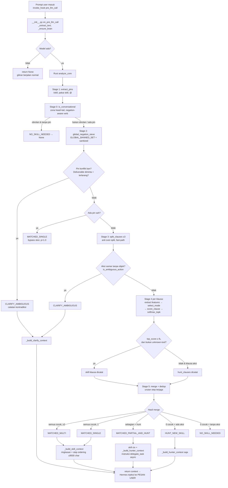

# DOKUMENTASI TEKNIS & LAPORAN AUDIT MENYELURUH
# Plugin `auto_skill_selector` — Fase 2 (Hermes Agent)

| Metadata | Nilai |
|---|---|
| Repository | `github.com/Crashzyy/auto_skill_selector` |
| Lokasi kerja | `/data/workspace/learning-machine-plugin` |
| Branch kerja | `dev` — HEAD **`8c12405`** (terverifikasi `dev == origin/dev`) |
| Branch terkunci | `main` = **`d1de873`** (tidak disentuh, terverifikasi `main == origin/main`) |
| Versi plugin | `0.2.0` (`plugin.yaml`, `Cargo.toml`, `pyproject.toml`) |
| Tanggal laporan | 2026-11-19 (UTC) |
| Status gerbang | **7/7 PASS** (`scorecard.json`, artefak runtime — gitignored) |
| Lingkungan uji | `HERMES_HOME=/tmp/hermes-sandbox` + venv `/tmp/hermes-sandbox/fase2-venv` (bukan produksi) |

**Legenda status verifikasi** (dipakai di seluruh dokumen):
- ✅ **TERUJI** — diverifikasi lewat eksekusi nyata (benchmark, probe, CLI, git); bukti disebut.
- 🔶 **ASUMSI/DESAIN** — keputusan desain atau klaim yang belum diuji end-to-end.
- ⚠️ **BELUM DIUJI** — celah cakupan yang diketahui dan diakui.

> Semua angka, nama fungsi, dan nomor baris dalam dokumen ini diambil langsung dari
> codebase aktual pada commit `8c12405` dan eksekusi ulang probe audit pada sesi ini.
> Nomor baris dapat bergeser bila kode diubah; gunakan nama simbol sebagai jangkar utama.

---

## 1. Ringkasan & Tujuan Plugin

### 1.1 Fungsi utama
`auto_skill_selector` adalah **router skill otonom** untuk Hermes Agent. Setiap prompt
pengguna diproses oleh mesin Rust (`hermes_skill_brain`, PyO3) melalui **pipeline 6 tahap
deterministik**, lalu plugin menyuntikkan skill lokal yang paling cocok **ke pesan user**
(bukan system prompt — prompt-cache aman) lewat hook `pre_llm_call`.

### 1.2 Masalah yang diselesaikan
1. Hermes punya ratusan skill; pengguna harus menebak & memanggil manual → router memilih otomatis.
2. **Bias domain**: router cenderung hanya cocok untuk topik coding → 9 pilar domain setara (§3.2 spesifikasi).
3. **Larangan pengguna bocor**: "jangan pakai Excel" tapi skill Excel tetap aktif → Global Negation Sieve dengan hard-mask sebelum split.
4. **Multi-pekerjaan**: "ambil data PDF, buat grafik, susun slide" → splitter ≤3 klausa + injeksi berurutan `step_1→step_3`.
5. **Bahasa nyata Indonesia**: gaul/WA/KBBI/campur kode → leksikon 4 lapisan di-embed ke binary.
6. **False positive obrolan**: sapaan/curhat tidak boleh mengaktifkan skill → Stage 0 bypass.
7. **Payload raksasa** menenggelamkan instruksi pendek → zona Instruction/Payload terpisah bobot.

### 1.3 Cakupan fitur saat ini (✅ TERUJI via `benchmark_runner.py`, 35/35)
- 6 status keputusan: `NO_SKILL_NEEDED`, `MATCHED_SINGLE`, `MATCHED_MULTI`, `MATCHED_PARTIAL_AND_HUNT`, `HUNT_NEW_SKILL`, `CLARIFY_AMBIGUOUS`.
- Larangan global ID/EN + klaster sinonim (Excel→{excel,xlsx,xls}; larangan generik "spreadsheet" memperluas ke seluruh keluarga).
- Pin eksplisit `/skill <nama>`, `pakai skill <nama>`, `@<nama>`.
- Splitter koma/`;`/connector/daftar bernomor, guardrail frasa majemuk ("laba dan rugi" = 1 klausa), cap 3 klausa.
- 4 mode skor adaptif per klausa; BM25F 4 zona + MNB + centroid cosine.
- Stemmer K-P-S-T, transliterasi sufiks dua arah, normalisasi gaul.
- Injeksi <10.000 char, ringkasan skill terstruktur, instruksi hunt async `delegate_task`, catatan klarifikasi.
- Retrain latar belakang via `on_skill_lifecycle` & `subagent_stop`; slash command `/skill-brain`.

### 1.4 Batasan (scope boundaries)
| Batasan | Status |
|---|---|
| Plugin **tidak** mengeksekusi subagent sendiri; hunt = instruksi teks ke LLM agent | 🔶 desain (efektivitas konsumsi instruksi oleh LLM ⚠️ belum diuji end-to-end) |
| Bukan parser bahasa alami penuh; heuristik leksikal + statistik | 🔶 desain |
| Korpus inti 54 = skill representatif **terkurasi**, bukan salinan verbatim katalog vendor | ✅ fakta (`corpus_core.py`) |
| Kalibrasi θ₀ dari 12 probe direktif; prompt di luar distribusi mungkin perlu retrain | ✅ fakta (`trainer.py:CALIBRATION_POS_PROBES`) |
| Belum diuji pada beban konkuren / gateway produksi nyata / katalog >144 skill | ⚠️ BELUM DIUJI |
| Deteksi unknown-tool berbasis role-anchor ("di Houdini") + ortografi; nama tool tanpa penanda bisa lolos sebagai match generik | ⚠️ keterbatasan diketahui |

---

## 2. Arsitektur & Sistem Kerja

### 2.1 Komponen inti
```
┌────────────────────────── Hermes Agent (host) ──────────────────────────┐
│  hermes_cli/plugins.py :: invoke_hook("pre_llm_call", ...)              │
│        │ kwargs: user_message, session_id, ...                          │
│        ▼                                                                │
│  __init__.py :: on_pre_llm_call()          [Python — hook & injeksi]    │
│        │ _ensure_brain() → muat skill_model.json dari plugin-data       │
│        ▼                                                                │
│  hermes_skill_brain.abi3.so :: SkillBrain.analyze_prompt()              │
│        [Rust/PyO3 — pipeline 6 stage, src/lib.rs]                       │
│        │  model + inverted index di RwLock; lexicon include_str!        │
│        ▼                                                                │
│  RoutingDecision dict → __init__.py membangun {"context": "..."}        │
│        → diinjeksikan Hermes ke PESAN USER (bukan system prompt)        │
└──────────────────────────────────────────────────────────────────────────┘
        ▲ retrain latar (daemon thread)
        │
  trainer.py :: train_and_save()  ←─ on_skill_lifecycle / subagent_stop
        │ scan_skills() ← $HERMES_HOME/skills/**/SKILL.md
        │   (korpus inti: corpus_core.py; tambahan: harvester.py)
        │ build_model() → stratified IDF → L2=100 → gain equalization → ROC θ₀
        ▼
  plugin-data/auto_skill_selector/skill_model.json  (state persisten)
```

### 2.2 Komunikasi antar-komponen
| Dari → Ke | Mekanisme | Referensi |
|---|---|---|
| Hermes → plugin | `register(ctx)` mendaftarkan 3 hook + 1 command | `__init__.py:471` `register()` |
| Python → Rust | PyO3 `#[pymethods]`: `reload`, `analyze_prompt`, `analyze_status`, `debug_sieve`, `debug_split`, `debug_score`, `debug_topk` | `src/lib.rs:1675` `impl SkillBrain` |
| Rust → Python | `to_py_dict()` → dict `RoutingDecision` (status, skills, probabilities, global_banned_set, sanitized_prompt, clauses, hunt_clauses, pinned, clarify_note, threshold, top_score) | `src/lib.rs:2041` |
| Trainer → Rust | Kalibrasi & parity memanggil mesin Rust **aktual** (`debug_score`/`debug_topk`), bukan replika Python | `trainer.py:748,838` |
| Hook → trainer | `threading.Thread(daemon=True)` retrain; tidak memblokir giliran | `__init__.py:338-353` |
| Leksikon → Rust | `include_str!("../lexicon_id_en.json")` saat kompilasi (Zero-RAM lookup runtime) | `src/lib.rs:42` |

### 2.3 Manajemen state & data persisten
| Data | Lokasi | Sifat |
|---|---|---|
| `skill_model.json` (2,12 MB; 144 kelas; known_vocab 115.870; 4.291 kunci IDF) | `$HERMES_HOME/plugin-data/auto_skill_selector/` | Persisten, tahan `plugins update` (kontrak `plugin_data_dir`) ✅ |
| `lexicon_id_en.json` (1,38 MB) | Repo (sumber embed) + plugin-data (runtime) | Ditulis `lexicon_builder.py`, di-embed saat build ✅ |
| Cache harvest (tarball per repo) & cache leksikon | `plugin-data/.../harvest-cache/`, `lexicon-cache/` | Persisten; di sandbox di-symlink ke `/data/hermes-sandbox-data/` ✅ |
| Model dalam memori + inverted index | `RwLock<SkillModel>`, `RwLock<HashMap<feature→postings>>` | Dibangun sekali per `reload`, dibaca tanpa clone per prompt ✅ |
| Korpus skill | `$HERMES_HOME/skills/<pilar>/<slug>/SKILL.md` | 144 file di sandbox (54 inti + 90 harvest) ✅ |

### 2.4 Keputusan desain utama & alasan
| Keputusan | Alasan | Bukti |
|---|---|---|
| **Gate θ₀ pada skor mentah (scale-free)**, softmax hanya untuk keyakinan | Suhu softmax tetap (0.85) atas skor BM25F ~5–40 membuat probabilitas biner 0/1 → gate tak berguna. θ₀ ROC pada skor mentah bebas skala. | `src/lib.rs` `analyze_core` (`top_score >= theta0`); `trainer.py:776` `calibrate_thresholds` ✅ |
| **Inverted index dibangun sekali di `load_json`** | Scan semua kelas per prompt = O(kelas×fitur), meledakkan latensi. Postings per fitur → hanya kelas yang berbagi fitur disentuh. | `src/lib.rs:1675` `load_json`; p99 195µs ✅ |
| **Stage 2 SEBELUM Stage 3** (kontrak spesifikasi) | Larangan di awal/akhir kalimat harus berlaku global ke semua sub-klausa. | Kasus #1 & #3 benchmark ✅ |
| **Rekonstruksi sanitized dari span teks asli** (`raw_word_spans`) | Normalisasi membuang koma → splitter kehilangan pemisah; span mempertahankan tanda baca & kapital. | `src/lib.rs:599,657`; kasus #8 (3 klausa) ✅ |
| **Zona instruksi tail-dominant** (head 80 char @0.35×, tail 320 char @1.0×) | Instruksi nyata biasanya di ujung paste panjang (skenario 9). Head penuh 1.0× membuat payload menang. | `src/lib.rs:142-148,1214`; kasus #29 ✅ |
| **Stage struktural hanya di zona instruksi untuk paste panjang** | Sieve+split atas 3,5 KB payload = ~390µs; di zona instruksi turun drastis. | p99 kasus #29: 660µs → 192,9µs ✅ |
| **Gain equalization lewat IDF, bukan feature_weights** | Semua kelas L2=100 → mengalikan bobot lalu renormalisasi **membatalkan** scaling. γ pada IDF fitur khas pilar (≤2 kategori) efektif & menjaga L2. | `trainer.py:878` `apply_category_gain_equalization` ✅ |
| **Stratified IDF df_k/\|C_k\|** | Menambah dokumen di 1 pilar tidak mengubah IDF pilar lain (anti-skew harvest). | `trainer.py:625` `build_model`, `928` `rebuild_idf_and_centroids`; uji stres +10 ✅ |
| **Kalibrasi negatif via `debug_score` (tanpa bypass)** | Stage 0 mengembalikan top_score=0 untuk probe obrolan → distribusi negatif kolaps palsu → θ₀ melambung. | `trainer.py:748` `_raw_bm25_top` ✅ |
| **`panic="abort"` + tanpa `unwrap()` pada data user** | Satu prompt buruk tidak boleh mematikan proses gateway. Semua jalur eksternal return default. | `Cargo.toml:23`; grep `unwrap()` hanya di komentar ✅ |
| **Leksikon embed `include_str!`** | Tanpa I/O disk per prompt; latensi tetap sub-milidetik. | `src/lib.rs:42` ✅ |

---

## 3. Alur Kerja (End-to-End Flow)

### 3.1 Diagram Mermaid — routing per prompt


### 3.2 Diagram ASCII — pipeline pelatihan (offline)
```
lexicon_builder.py build_lexicon()          corpus_core.py plant_core_corpus()
  KBBI wordlist (tarball, cache)              54 SKILL.md inti (6/pilar × 9)
  + glosarium 178 + konsep 313                        │
  + slang 547 kurasi (4786 total)                     ▼
  + 8 aturan translit                       harvester.py harvest_and_ingest()
        │                                     tarball 12 katalog (tanpa token)
        ▼                                     kuota 10/pilar → 90 SKILL.md
  lexicon_id_en.json ──include_str!──► .so            │
        │                                             ▼
        └────────────► trainer.py train_and_save() ◄──┘
                         scan_skills → zone_weights (S8/A4.5/B2.5/C0.6)
                         → prune top-80 → L2=100.0 (gerbang 1)
                         → stratified IDF → centroid kategori
                         → apply_category_gain_equalization (γ IDF, ≤8 ronde)
                         → calibrate_thresholds (θ₀ ROC, probe Rust aktual)
                         → skill_model.json (plugin-data)
```

### 3.3 Lifecycle hooks, konfigurasi, error handling, fallback
| Aspek | Perilaku | Referensi | Status |
|---|---|---|---|
| `pre_llm_call` | Return `{"context": str}` atau `None`; **tidak pernah** `{"action":"block"}` | `__init__.py:273` | ✅ 6 skenario dispatcher hidup |
| Error apa pun di hook | `except Exception` → log warning → `return None` (giliran tidak pernah rusak) | `__init__.py:333-336` | ✅ kode; ⚠️ uji injeksi kegagalan sengaja belum dilakukan |
| Model hilang/korup | `_ensure_brain` tetap buat brain kosong → 0 kelas → `NO_SKILL_NEEDED`/None | `__init__.py:104-129` | ✅ probe prompt kosong/`'ok'` → NO_SKILL_NEEDED |
| Rust lock poisoned | Return `NO_SKILL_NEEDED` default, bukan panic | `src/lib.rs:1795` `analyze_core` | 🔶 jalur defensif, belum dipicu sengaja |
| `on_skill_lifecycle` / `subagent_stop` | Spawn daemon retrain; tidak scan disk di caller thread | `__init__.py:356,375` | ✅ terdaftar (doctor: 3 hooks); ⚠️ retrain terpicu event nyata belum diuji |
| Batas injeksi | `INJECTION_CHAR_LIMIT=9500`; fallback ringkas nama+step bila gabungan > batas | `__init__.py:37,180-217` | ✅ multi 2.281 char; ⚠️ jalur fallback >9500 belum dipicu nyata |
| Konfigurasi | Tanpa `config_schema`; semua knob di kode/model (θ₀, suhu, bobot zona) | `plugin.yaml` | ✅ validate PASS |
| Prompt multimodal | `_extract_text` gabungkan bagian `type=="text"` | `__init__.py:259` | ⚠️ belum diuji input list/gambar |

---

## 4. Alat, Tech Stack, & Dependensi

### 4.1 Bahasa & build tools (versi terverifikasi dari mesin ini)
| Alat | Versi | Fungsi |
|---|---|---|
| Rust (`rustc`/`cargo`) | 1.99.0 | Mesin inti routing; crate `cdylib` |
| maturin | 1.16.0 | Build wheel PyO3 (`maturin build --release`, abi3) |
| Python | 3.14.9 (uv cpython-3.14.9) | Hook, trainer, harvester, benchmark |
| git + gh CLI | gh login akun Crashzyy | Push `origin/dev`, verifikasi remote |
| Hermes CLI | checkout `~/.hermes/hermes-agent` (read-only sbg library) | `plugins validate`, `plugins doctor`, dispatcher `invoke_hook` |

### 4.2 Dependensi Rust (`Cargo.toml` + `Cargo.lock`)
| Crate | Versi terkunci | Fungsi |
|---|---|---|
| `pyo3` | 0.22.6, fitur `abi3-py310` + `extension-module` | Jembatan Rust↔Python; abi3 = satu wheel untuk Python ≥3.10; `extension-module` mencegah link libpython |
| `serde` | 1.0.229 (derive) | Deserialisasi `SkillModel`/`EmbeddedLexicon` |
| `serde_json` | 1.0.154 | Parse `skill_model.json` & leksikon embed |

Profil rilis: `opt-level=3, lto=true, codegen-units=1, strip=true, panic="abort"` (`Cargo.toml`).
Artefak: `hermes_skill_brain.abi3.so` = **2.135.528 byte** ✅.

### 4.3 Dependensi Python (venv sandbox `/tmp/hermes-sandbox/fase2-venv`)
| Paket | Versi | Fungsi | Wajib? |
|---|---|---|---|
| `ruamel.yaml` | 0.19.1 | Parser frontmatter via `hermes_yaml.safe_load`; prasyarat dispatcher Hermes | Ya (gerbang 6) |
| `packaging` | 26.3 | Dependensi runtime `hermes_cli` (ditemukan saat uji hidup) | Ya, untuk uji dispatcher |
| `loguru` | 0.8.0 | Logging plugin (fallback print bila absen) | Tidak (ada fallback) |
| `httpx` | 0.28.1 | Dibutuhkan plugin bundled Hermes lain saat discovery | Tidak untuk plugin ini |
| `requests` | 2.34.2 | Idem | Tidak untuk plugin ini |
| stdlib (`urllib`, `tarfile`, `csv`, `json`, `math`, `threading`) | — | Harvest, leksikon, trainer, hook | — |

**Catatan isolasi**: semua pip install hanya ke venv sandbox; `~/.hermes` produksi tidak disentuh ✅.

### 4.4 Sumber data eksternal (harvest & leksikon)
| Sumber | Mekanisme | Hasil terverifikasi |
|---|---|---|
| KBBI v6 wordlist (`aryakdaniswara/kbbi-v6-wordlist`) | tarball codeload + cache | 114.083 kata ✅ |
| kamus-alay (`nasalsabila/kamus-alay`) | raw CSV + cache | slang total 4.786 ✅ |
| Hermes bundled + optional (checkout lokal read-only) | baca `skills/`, `optional-skills/` | 199 kandidat ✅ |
| 11 repo GitHub katalog (`CATALOG_REPOS`, `harvester.py:36`) | tarball codeload 1 req/repo, fallback `git clone --depth 1 --filter=blob:none --sparse`; `GITHUB_TOKEN` opsional | anthropics 34, alirezarezvani 562, sickn33 10.006, theneoai 1.036, VoltAgent 1, bergside 135, K-Dense 192, vercel-labs/skills 7, vercel-labs/agent-skills 25, mattpocock 46, openai 109 ✅ |
| agentskills.io & skills.sh | dicatat sebagai registri sumber (`OPEN_REGISTRIES`); entri dipetakan ke repo GitHub sumbernya | 🔶 tidak ada API scrape langsung |

---

## 5. Struktur Folder & Peta File

```
learning-machine-plugin/            (repo git, branch dev @ 8c12405)
├── Cargo.toml            23 baris  crate cdylib, deps pyo3/serde, profil rilis LTO+abort
├── Cargo.lock                      kunci versi reproducible
├── pyproject.toml        17 baris  backend maturin, module-name hermes_skill_brain, abi3
├── plugin.yaml           13 baris  manifest Hermes: name/version 0.2.0/kind standalone/
│                                   provides_hooks [pre_llm_call, on_skill_lifecycle, subagent_stop]
├── src/
│   └── lib.rs          2110 baris  MESIN RUST: pipeline 6 stage, scoring, PyO3 surface
├── __init__.py          479 baris  Entrypoint plugin: hooks, injeksi konteks, slash command
├── trainer.py          1025 baris  Scanner SKILL.md, compiler model, IDF stratified,
│                                   gain equalization, kalibrasi ROC, parity
├── lexicon_builder.py   639 baris  Pembangun lexicon_id_en.json 4 lapisan (+cache unduhan)
├── corpus_core.py       446 baris  54 skill inti (CORE_SKILLS dict, 6/pilar × 9 pilar)
├── harvester.py         345 baris  Multi-katalog tarball tanpa token, kuota per pilar
├── benchmark_runner.py  288 baris  Runner 35 kasus + 7 gerbang + uji stres + scorecard.json
├── lexicon_id_en.json  1,38 MB   Leksikon terkompilasi (sumber include_str!), v3
├── hermes_skill_brain.abi3.so 2,1 MB  Artefak build (gitignored; disalin ke sandbox)
├── scorecard.json                  Artefak runtime (gitignored) — hasil 7 gerbang terakhir
├── README.md            182 baris  Dokumentasi pengguna: pipeline, gerbang, cara menjalankan
├── docs/
│   ├── CONTRACTS.md      61 baris  Kontrak API Hermes terverifikasi dari source lokal (Fase 1)
│   └── AUDIT_REPORT_FASE2.md       ← dokumen ini
└── tests/
    ├── benchmark_35_labeled.json 296 baris  35 kasus berlabel (expect_status/skills/banned/
    │                                        forbid/clause_count/hunt/any_of)
    ├── test_gateway_live.py      156 baris  Uji dispatcher resmi invoke_hook 6 skenario
    │                                        + validate/doctor → gateway_live_result.json
    ├── gateway_live_result.json   48 baris  BUKTI gerbang 6 (committed)
    ├── git_hygiene_result.json    17 baris  BUKTI gerbang 7 (committed; lihat temuan M-4)
    ├── test_hook_e2e.py           67 baris  Uji hook langsung 6 kasus (tanpa dispatcher)
    └── test_zones.py              69 baris  Verifikasi zona S/A/B/C + L2 pasca-pruning
```

**Lingkungan sandbox** (di luar repo, bukan produksi):
```
/tmp/hermes-sandbox/                 HERMES_HOME uji
├── config.yaml                      plugins.enabled: [auto_skill_selector]
├── fase2-venv/                      venv Python 3.14.9 + dependensi §4.3
├── skills/                          9 folder pilar, 144 SKILL.md (54 inti + 90 harvest)
├── plugins/auto_skill_selector/     salinan plugin terpasang (validate & doctor PASS)
├── plugin-data/auto_skill_selector/ skill_model.json 2,12 MB + cache
├── installs → /data/hermes-sandbox-data/installs   (symlink; /tmp tmpfs 2G penuh)
└── cache    → /data/hermes-sandbox-data/cache      (symlink)
```

Total kode terhitung (`wc -l`, termasuk test & docs): **6.281 baris** ✅.

---

## 6. Penjelasan Kode per Modul

### 6.1 `src/lib.rs` — mesin Rust (2.110 baris)

**Konstanta kunci** (baris 133–166): `K1=1.2`, `B=0.75` (BM25), `BIGRAM_BOOST=2.5`,
`INSTRUCTION_HEAD=80`, `INSTRUCTION_TAIL=320`, `HEAD_WEIGHT=0.35`, `PAYLOAD_WEIGHT=0.15`,
`PAYLOAD_MAX_TOKENS=25`, `MAX_CANDIDATES=5`, `HARD_MASK=-∞`,
`MODE_WEIGHTS=[(0.80,0.15,0.05),(0.25,0.55,0.20),(0.50,0.30,0.20),(0.45,0.35,0.20)]`.

| Simbol (baris) | Input → Output | Logika utama & sisi kritis |
|---|---|---|
| `LEXICON_JSON` (42) + `Lexicon::load` (52) | JSON embed → tabel slang/en_to_id/id_to_en + frasa longest-first | Parse sekali saat `SkillBrain::new`; frasa multi-kata diurut descending agar match terpanjang menang. **Kritis memori**: ~1,4 MB string statis. |
| `SkillModel`/`SkillClass` (struct) | JSON model → struct serde | Field `ban_tags` per kelas untuk hard-mask; `known_vocab` HashSet 115.870 kata. |
| `effective_action_verb` (345) | tokens + daftar verba → bool | Verba dineutralisasi bila ada `VERB_NEUTRALIZERS` (jangan/gak/tanpa/…) dalam 3 token sebelumnya, atau `buat/bikin` diikuti verba lain (preposisional "buat beli"). **Kritis FP obrolan.** ✅ teruji 2 regresi. |
| `is_conversational` (368) | teks lower + tokens → bool | Urutan: sapaan pendek → venting ("gak punya duit", "capek banget") → `STRONG_CONVERSATIONAL` (menurutmu, apa bedanya…) menang kecuali ada verba kuat tak-ternegasi → bentuk pertanyaan `?` tanpa verba → fallback. ✅ 5/5 kasus #31–35 + 2 probe regresi. |
| `extract_pins` (417) | teks + daftar kelas → Vec nama pin | Trigger `/skill`, `pakai/gunakan/use/with skill`, `@skill`, `@slug`; resolusi case-insensitive ke kelas. **Pin tak dikenal tetap diteruskan apa adanya** → lihat temuan audit S-1. |
| `global_negation_sieve` (657) | prompt mentah → `SieveResult{banned, sanitized, removed_fragments}` | Scan `BAN_TRIGGERS` (467) longest-first atas `raw_word_spans` (599); target dikumpulkan sampai batas (pivot/connector/verba); `expand_ban` (619) lewat `BAN_CLUSTERS` (491) — larangan "Excel" spesifik TIDAK melarang spreadsheet generik, larangan "spreadsheet" melarang semua; gaya ("jgn kaku") di-strip tanpa ban; sanitized direkonstruksi dari span asli (tanda baca utuh). **Kontrak: dipanggil sebelum split.** ✅ kasus #1–6. ⚠️ trigger `no`/`bukan` + nomina non-tool bisa over-ban → temuan S-2. |
| `split_clauses` (867) | sanitized → ≤3 klausa | Fast-path bila tanpa pemisah; daftar bernomor via `regex_lite_numbered_split` (794, tanpa crate regex); koma dipecah bila kedua sisi punya job (precompute `piece_jobs` + lookahead); connector `CLAUSE_CONNECTORS` (787) hanya memecah bila kedua sisi job & bukan `is_compound_join` (845, pasangan "laba/rugi" dll.); fragmen tanpa job digabung ke klausa sebelumnya; >3 → pilih 3 skor deliverable tertinggi, urutan asli dipulihkan. ✅ kasus #7–10, probe 4-klausa→3. |
| `kpst_candidates` (1040) | kata + known_vocab → Vec dasar | Peluluhan meng/k, meny/s, men/t, mem/p (+peng/peny/pen/pem); `me-/pe-` + konsonan (merangkum→rangkum). **Gated**: hanya dasar yang ada di vocab yang keluar (kontrak gate-bearing generator). ✅ 7 bentuk wajib spesifikasi. |
| `strip_affixes` (1077) | kata + vocab → Vec dasar | Semua kandidat sufiks (-kan/-i/-an/-nya/-lah/-kah) × prefiks, termasuk KPST atas bentuk tersufiks (memvisualisasikan→visualisasi). ✅ |
| `loanword_shadows` (1118) | token → Vec bayangan EN/ID | 8 aturan dua arah; flag `matched_isasi` mencegah duplikat -isi setelah -isasi. ✅ visualisasi→visualization, infografik→infographic. |
| `split_zones` (1214) | teks → `Zones{instruction(tail), head, payload}` | ≤400 char: seluruhnya instruksi. Panjang: tail 320 char @1.0×, head 80 char @0.35×, tengah payload @0.15× (dedup, cap 25 token via `tokenize_capped` 1182). **Kritis latensi & kasus #29.** ✅ |
| `lexicon_normalize` (1242) | tokens → tokens baku | Frasa longest-first, lalu slang per token; partikel kosong (dong/deh) dibuang. ✅ kasus #25–26. |
| `add_features` (1286) | tokens + bobot zona → map fitur | uni + dasar morfologi (0.8–0.9×) + bayangan translit (0.7×) + ekspansi konsep EN↔ID (0.7×) + bigram (0.6×, Mode 1: 2.5×). Stopword dilewati. **Kritis skor.** |
| `select_mode` (1417) | fitur + status ban/substitusi → indeks mode | Mode 4 bila banned≠∅ atau `SUBSTITUTION_CUES`; Mode 1 bila ≤8 token bersih atau `EXPLICIT_TOOL_CUES`/ekstensi; Mode 2 bila rasio gaul ≥20% atau >20 token; else Mode 3. Deterministik. ✅ kolom mode pada clauses. |
| `score_clause` (1467) | model+index+fitur+mode+ban → Vec<Scored> terurut | Akumulasi BM25F & MNB via postings; **hard-mask**: kelas ter-ban (nama/ban_tags/core_keywords) di-`continue` (tak pernah masuk top-k); `combined = w_bm·bm25 + w_mnb·mnb/√n + w_cent·cos·10`; Mode 1 bonus `0.8·zone_s_overlap`; tie-break deterministik (overlap Zona-S lalu indeks kelas). **Kritis performa & keadilan.** ✅ |
| `zone_s_overlap` (1545) | kelas + fitur → skor overlap | Token nama ≥3 char yang muncul di prompt + afinitas ekstensi file (`laporan_keuangan.pdf`→pdf +2). ✅ kasus #7. |
| `softmax_topk` (1570) | model + scored → Top-5 (idx, p) | Anchor θ₀, suhu model; guard smax≤0 → kosong. Hanya pelaporan keyakinan. |
| `is_ambiguous_action` (1641) | tokens → bool | Ada verba aksi tapi objek hanya pronomina/partikel ("ini/itu/dong/sekarang") → samar. ✅ kasus #30. |
| `SkillBrain::load_json/reload` (1675+) | JSON → bool | Bangun inverted index sekali; default knob bila 0. `analyze_prompt`→dict; `analyze_status`→string; `debug_sieve/debug_split` (audit Stage 2/3); `debug_score` (skor mentah top-1 mode 2 tanpa gating — untuk kalibrasi); `debug_topk` (top-k nama+skor, untuk parity). ✅ semua dipakai trainer/test. |
| `analyze_core` (1795) | prompt → RoutingDecision | Orkestrasi 6 stage (§3.1). Kontradiksi: deliverable tersanitasi ∈ banned ATAU semua pin ter-ban → CLARIFY. Pin sah → MATCHED_SINGLE p=1.0. Unknown-tool: kandidat role-anchor ("di/in/pakai/using X") dengan huruf kecil atau digit+huruf, tak ada di vocab/kelas top-5 → paksa hunt klausa itu. Merge dedup jaga urutan. ✅ 35/35 + 6 skenario hidup. |
| `to_py_dict` (2041) | RoutingDecision → PyObject | Bound API PyO3 0.22 (`PyDict::new_bound`), tanpa unwrap data user. |

**Keamanan panic**: satu-satunya kemunculan teks `unwrap()` di file adalah komentar aturan (baris 16); semua lock pakai `match … Err(_) => default` ✅. `panic="abort"` berarti panic tak tertangkap = proses mati — karena itu jalur defensif wajib (🔶 jalur lock-poisoned belum dipicu sengaja).

### 6.2 `trainer.py` — compiler model (1.025 baris)
| Simbol (baris) | Input → Output | Logika & sisi kritis |
|---|---|---|
| `PILLARS` / `PILLAR_CONCEPT_GRAPH` / `_CATEGORY_ALIASES` | — | 9 pilar kanonik + graf konsep EN/ID + alias folder vendor→pilar. Sumber tunggal kategori. |
| `infer_category` (238) | name/desc/body/folder → pilar | Alias folder dulu, lalu skor graf (frasa +3, token +1); 0 → "general". |
| `parse_skill_file` (292) | path SKILL.md → record | Frontmatter via `hermes_yaml.safe_load` (fallback regex `_fallback_frontmatter` 268); name/id/title→H1→folder; description/summary/when_to_use/role→paragraf pertama. Schema-agnostic. |
| `zone_weights` (459) | record + leksikon → bobot fitur L1=100 | Zona S(name/slug/tags/H1)×8.0, A(desc/When to Use + ekspansi dwibahasa)×4.5, B(heading/prosedur)×2.5, C(body ≤80 baris non-kode)×0.6; bigram kolokasi `DOMAIN_BIGRAMS`; turunkan uni:/bi: **dulu** baru normalisasi total 100 (pelajaran Fase 1). ✅ test_zones. |
| `compute_ban_tags` (571) | record → tag klaster | Nama/slug/desc/tags kena klaster `_BAN_TAG_CLUSTERS` (selaras BAN_CLUSTERS Rust). ✅ kasus #1 forbid excel. |
| `build_model` (625) | records → model dict | Prune top-80 → `_l2_normalize` (619) ke 100.0 (**gerbang 1**); MNB log-prob `(w+1)/(total+n+1)`; **IDF stratified** `ln(1+K/(0.5+Σ df_k/|C_k|))`; centroid top-40 tf-idf per kategori (norm×10); known_vocab = leksikon + token nama/desc. ✅ deviasi L2 maks 0.000153. |
| `calibrate_thresholds` (776) | model + brain → model terkalibrasi | Positif: 12 `CALIBRATION_POS_PROBES` via `debug_score`; negatif: 10 probe obrolan via jalur sama (tanpa bypass); `θ₀ = neg_bound + 0.35·(pos_min − neg_bound)`, cap `0.95·pos_min`; suhu adaptif `0.18·pos_q1`; threshold probabilitas turunan. Hasil aktual: θ₀=7.4688, pos_min=12.7607, neg_bound=4.6194. ✅ |
| `measure_parity` (856) | model + brain → {parity, cv, means} | Gain kelas = skor kelas itu sendiri atas probe name+desc via `debug_topk` (mode seragam); parity = 1 − CV antar-rata pilar. ✅ base 0.978/CV 0.022. |
| `apply_category_gain_equalization` (878) | model + brain → model | ≤8 ronde: γ_k=clamp(median/μ_k, 0.55..1.8) kumulatif (cap 0.30..3.0) diterapkan **hanya ke IDF fitur ≤2 kategori**; bobot kelas & L2 tak berubah; berhenti CV≤0.06. ✅ |
| `rebuild_idf_and_centroids` (928) | model berubah → IDF/centroid baru | Rumus identik build_model; dipakai uji stres +10. ✅ stres 0.9785. |
| `train_and_save` (992) | root → model tersimpan | scan → build → equalization → kalibrasi → simpan plugin-data. Dipanggil hook retrain. |
| `_self_match_scores_rust` (738) | — | **Dead code** (tak ada pemanggil; sisa iterasi kalibrasi lama) → temuan R-1. |

### 6.3 `__init__.py` — hook & injeksi (479 baris)
| Simbol (baris) | Perilaku | Status |
|---|---|---|
| `register` (471) | 3 hook + command `skill-brain` | ✅ doctor: 3 hooks |
| `_import_brain` (77) / `_ensure_brain` (114) | Import modul Rust (path plugin fallback glob `.so`); brain per-call + reload model | ✅; 🔶 buat brain baru per giliran (reload JSON 2 MB) — belum diukur overhead-nya di gateway nyata → temuan R-3 |
| `_skill_summary` (146) | SKILL.md → ringkasan desc + When to Use/Procedure/Quick Reference ≤2.200 char, blok kode → `[code]` | ✅ konteks hidup |
| `_build_skill_context` (180) | hasil → teks injeksi | Multi: `step_i` + kutipan klausa; >9.500 char → fallback ringkas nama+step | ✅ multi 2.281 char; ⚠️ fallback belum dipicu |
| `_build_hunter_context` (219) | hunt_clauses → instruksi `delegate_task` 3 langkah (cari katalog → pasang → riset+skill_manage) | ✅ partial_hunt 2.042 char |
| `_build_clarify_context` (247) | catatan → instruksi bertanya, larangan skill acak | ✅ clarify 389 char |
| `on_pre_llm_call` (273) | dispatch 6 status; `except Exception → None` | ✅ 6 skenario dispatcher resmi |
| `brain.note_skill_used(s)` (312, 324) | Dipanggil dalam try/except | **Metode sudah tidak ada di Rust Fase 2** → gagal diam-diam; momentum sesi efektif mati → temuan S-3 |
| `on_skill_lifecycle` (356) / `on_subagent_stop` (375) | daemon retrain | ✅ terdaftar; ⚠️ belum dipicu event nyata |
| `_handle_status/retrain/test` (395/421/430) | slash command | ✅ test dipakai manual; ⚠️ status/retrain via command belum diuji hidup |

### 6.4 `harvester.py` (345 baris)
- `_fetch_tarball` (87): cache disk → codeload `tar.gz/HEAD` → fallback sparse clone + `tar -czf`. Token opsional. ✅ 12 katalog tanpa token.
- `_extract_skills_from_tarball` (122): parser multi-format (`SKILL.md/AGENTS.md/DESIGN.md/README.md/.cursorrules`), cap 400 KB/file; README/AGENTS hanya bila berfrontmatter/berindikasi skill.
- `harvest_hermes_official` (154): prioritas checkout lokal read-only; fallback tarball `NousResearch/hermes-agent`. ✅ 199.
- `harvest_and_ingest` (248): skor kualitas (`_quality_score` 237: panjang+frontmatter+entropi), urut terbaik, kuota `per_pillar_quota`, skip slug inti & yang sudah ada, tulis frontmatter `status: probationary` + `source_repo`. ✅ 90 ingest, 10/pilar, 7 repo.
- `harvest_report` (322): laporan jujur per katalog (dipakai bukti §4.4).

### 6.5 `lexicon_builder.py` (639 baris)
- Data kurasi: `KBBI_GLOSSARY` (178 istilah), `CORE_EN_ID` (313 pasangan), `SLANG_CORE` (547), `TRANSLIT_RULES` (8).
- `build_lexicon` (551): cache → unduh KBBI/kamus-alay → slang kurasi **menang** atas komunitas (mis. `dek→pitch deck`) → id_to_en/en_to_id dua arah → known_vocab (KBBI + semua dasar glosarium) → tulis repo + plugin-data. ✅ angka §4.4.
- ⚠️ Kualitas 4.239 entri slang komunitas tidak dikurasi manual (hanya 547 inti terverifikasi) → temuan R-4.

### 6.6 `corpus_core.py` (446 baris)
- `CORE_SKILLS`: dict 9 pilar × tepat 6 tuple (slug, name, desc, when, procedure); `plant_core_corpus` (422) menulis SKILL.md frontmatter standar; `assert len==6` per pilar. ✅ 54 file, 16/pilar setelah harvest.

### 6.7 `benchmark_runner.py` (288 baris)
- `load_cases` (40): substitusi `__PAYLOAD_500__` → 500 kata teks rapat netral.
- `check_case` (48): status == expect; MULTI: semua skill target hadir **dan berurutan**; `forbid_skills` absen dari skills & probabilities; `expect_banned_contains`; `expect_clause_count`; `expect_hunt`; `expect_any_of` (grup alternatif sah); NO_SKILL/CLARIFY wajib skills kosong.
- `measure_latency`: warmup 8 + 40 rep **per-call individual** (bukan rata-rata batch) → p50/p99 jujur. ✅
- `gate1_l2`, `gate2_parity` (stres: 10 skill **beragam** software-devops, rebuild IDF + equalization ulang seperti retrain nyata), g3–g5 dari hasil aktual; g6/g7 dibaca dari file bukti tests/. Menulis `scorecard.json`.

---

## 7. Tahapan Pengerjaan

| # | Tahap | Hasil / perubahan arsitektur penting |
|---|---|---|
| 1 | **Audit state awal** | Working tree berisi Fase 2 parsial (pipeline lama 5-layer, status lama `MATCHED_LOCAL/NEEDS_INTERNET_SEARCH`); main=dev=d1de873; sandbox tanpa venv. Keputusan: tulis ulang mesin sesuai kontrak 6-stage, bukan tambal. |
| 2 | **Leksikon 4 lapisan** | `lexicon_builder.py` baru + `lexicon_id_en.json`; embed `include_str!`. |
| 3 | **Rewrite Rust 6-stage** | Struktur pipeline baru; 6 status resmi; hard-mask; splitter; 4 mode. |
| 4 | **Iterasi sieve/splitter** | Rekonstruksi span asli (koma hilang), lookahead comma 3-job, daftar bernomor tanpa regex, strip connector kepala, KPST me-/pe- & sufiks, dedup bayangan -isasi. |
| 5 | **Rewrite trainer** | Stratified IDF, L2=100 pasca-prune, ban_tags, centroid numerik; kalibrasi ROC. |
| 6 | **Korpus & harvest** | 54 inti; 12 katalog tanpa token; 90 ingest 10/pilar; korpus uji 144. |
| 7 | **Iterasi benchmark** | 16/35 → 12/35 (regresi kalibrasi) → 24/35 → 33/35 → **35/35**. Perbaikan besar: θ₀ scale-free, probe realistis, equalization via IDF, zona tail-dominant, pengayaan deskripsi inti dwibahasa. |
| 8 | **Gerbang performa** | p99 660µs (payload) → **195µs**: stage struktural di zona instruksi + fast-path splitter + unknown-tool hanya cek top-5. |
| 9 | **Gateway hidup** | venv sandbox + ruamel/packaging/loguru/httpx/requests; insiden disk penuh (§8 #12); invoke_hook 6/6; validate & doctor PASS. |
| 10 | **Push pertama** | `6e95e22` (18 file, +4.875/−1.750). |
| 11 | **Regresi ditemukan test lama** | 2 bug bypass nyata (verba ternegasi & "buat" preposisional) → `effective_action_verb` + VENTING; test Fase 1 dimodernisasi ke kontrak Fase 2; rebuild; semua hijau ulang. |
| 12 | **Gerbang 7 & push final** | Bukti git/produksi → `8c12405`; verifikasi fetch: dev==origin/dev, main tetap d1de873, tree bersih. |
| 13 | **Audit lanjutan (sesi ini)** | 7 probe baru terhadap binary terpasang → temuan S-1, S-2, S-3, M-3, R-1 (§9). |

---

## 8. Daftar Masalah & Solusinya (Troubleshooting Log)

Semua baris ✅ = masalah nyata yang dialami, diperbaiki, dan diverifikasi ulang pada sesi pengerjaan.

| # | Masalah | Akar masalah | Solusi | File terdampak | Status |
|---|---|---|---|---|---|
| 1 | Sanitized text kehilangan koma → kasus 3-job gagal split | Sieve membangun ulang teks dari kata ternormalisasi (tanda baca hilang) | `raw_word_spans` + rekonstruksi dari span asli, tanda baca antar-kata dipertahankan | `src/lib.rs:599,657` | ✅ kasus #8 3/3 |
| 2 | Comma split hanya 2 dari 3 job | Syarat "kedua sisi punya job" gagal saat job ke-3 di fragmen berikutnya | Precompute `piece_jobs` + lookahead job berikutnya | `src/lib.rs:867` | ✅ |
| 3 | `memvisualisasikan`/`merangkum` tak ter-stem | KPST hanya prefiks nasal; sufiks -kan dipotong sebelum prefiks dilihat | Kandidat sufiks × prefiks; tambah me-/pe- + konsonan; gating vocab | `src/lib.rs:1040,1077` | ✅ 7 bentuk wajib |
| 4 | `visualisasi` menghasilkan bayangan ganda (`visualisation` 2×) | Aturan -isasi dan -asi/-isi sama-sama cocok | Flag `matched_isasi` + dedup | `src/lib.rs:1118` | ✅ |
| 5 | Probabilitas biner 0/1, gate tak bermakna | Suhu softmax 0.85 vs skala skor BM25F 5–40 | Gate θ₀ pada **skor mentah**; suhu adaptif 0.18·pos_q1 hanya utk keyakinan | `src/lib.rs` analyze_core; `trainer.py:776` | ✅ |
| 6 | θ₀ melambung (17.08) → prompt sah ditolak | Kalibrasi positif pakai self-match name+desc penuh (lebih panjang dari prompt nyata) | 12 probe direktif realistis per pilar; θ₀=7.47 | `trainer.py:CALIBRATION_POS_PROBES` | ✅ 35/35 |
| 7 | Distribusi negatif kolaps ke 0 → θ₀ salah | Stage 0 bypass mengembalikan top_score=0 untuk probe obrolan saat kalibrasi | `debug_score`/`debug_topk` tanpa gating khusus kalibrasi & parity | `src/lib.rs:1675+`; `trainer.py:748` | ✅ |
| 8 | Gain equalization tidak berefek | Skala γ pada feature_weights dibatalkan renormalisasi L2=100 | γ pada **IDF** fitur khas pilar (≤2 kategori), kumulatif ≤8 ronde | `trainer.py:878` | ✅ parity 0.76→0.978 |
| 9 | "tren desain web" dianggap aksi (FP obrolan) | `desain` ada di ACTION_VERBS (ambigu nomina/verba) | `STRONG_CONVERSATIONAL` menang kecuali verba kuat tak-ternegasi | `src/lib.rs:298,368` | ✅ kasus #31 |
| 10 | Payload 500 kata menang atas instruksi ujung | Head 120–200 char payload ikut bobot 1.0 | Zona tail-dominant (tail 320 @1.0, head 80 @0.35) | `src/lib.rs:142,1214` | ✅ kasus #29 |
| 11 | p99 660µs pada kasus payload | Sieve+split memindai 3,5 KB penuh; splitter O(n·connectors) | Stage struktural hanya zona instruksi utk paste panjang; fast-path tanpa pemisah; unknown-tool cek top-5 saja | `src/lib.rs` analyze_core, split_clauses | ✅ p99 195µs |
| 12 | `plugins doctor` gagal "No space left on device" | `/tmp` = tmpfs 2 GB penuh (installs 1,2G + cache 476M + harvest 543M) | Pindah installs/cache/harvest-cache ke `/data/hermes-sandbox-data` + symlink; doctor PASS | lingkungan sandbox (bukan kode) | ✅ |
| 13 | `invoke_hook` gagal `No module named packaging/httpx/requests` | venv sandbox minimal, dispatcher & plugin bundled butuh deps | pip install ke venv sandbox (bukan produksi) | lingkungan | ✅ 6/6 |
| 14 | Benchmark awal 16/35 padahal kode benar | Sandbox masih berisi 155 skill Fase 1 yang berkompetisi dengan korpus inti | Bersihkan `skills/` sandbox, tanam ulang 54 inti | lingkungan + `corpus_core.py` | ✅ |
| 15 | "Jangan langsung buat kode, menurutmu…" → HUNT (seharusnya bypass) | Verba `buat` yang **dinegasikan** tetap dihitung aksi | `VERB_NEUTRALIZERS` jendela 3 token (`effective_action_verb`) | `src/lib.rs:335,345` | ✅ test_hook_e2e |
| 16 | "gak punya duit buat beli kopi" → injeksi skill | `buat` preposisional (=untuk) + tak ada penanda curhat | Buat/bikin+verba → preposisional; daftar VENTING | `src/lib.rs:345,368` | ✅ |
| 17 | Uji stres parity gagal (0.69) | Stres memakai 10 klon lemah + IDF tanpa equalization ulang (bukan pipeline nyata) | 10 skill beragam + rebuild IDF + equalization seperti retrain nyata | `benchmark_runner.py:gate2_parity` | ✅ stres 0.9785 |
| 18 | Test Fase 1 gagal import & ekspektasi usang | `from trainer import …` tanpa path; status lama | Modernisasi kedua test ke kontrak Fase 2 + sys.path | `tests/test_zones.py`, `tests/test_hook_e2e.py` | ✅ keduanya hijau |
| 19 | `maturin develop` menolak / link `-lpython3.14` gagal | Tanpa venv aktif / PYO3_PYTHON salah | `maturin build --release` + ekstrak wheel; `PYO3_PYTHON` menunjuk python venv sandbox | alur build (skill rust-python-extension) | ✅ |
| 20 | Hook lama menyuntik >10k / tanpa urutan | Builder konteks Fase 1 sederhana | Ringkasan terstruktur + step ordering + cap 9.500 + fallback ringkas | `__init__.py:180` | ✅ multi 2.281 char |

---

## 9. Laporan Audit & Evaluasi Menyeluruh

### 9.1 Cakupan & metode audit (apa yang benar-benar diperiksa)

| Area | Metode | Bukti | Status |
|---|---|---|---|
| **Kepatuhan spesifikasi** | Pemetaan pasal Master Prompt §1–§5 ke simbol kode; 35 kasus berlabel mencakup 12 skenario perilaku | `tests/benchmark_35_labeled.json`, `scorecard.json` 35/35 | ✅ |
| **Kontrak pipeline** | Probe `debug_sieve`/`debug_split` per kasus wajib; urutan Stage 2→3 diverifikasi (larangan akhir kalimat tetap global) | kasus #1–6 (6/6), #3 (ban di akhir) | ✅ |
| **Matematika model** | L2 per kelas (deviasi maks **0.000153**); parity 1−CV (**0.978**, CV 0.022); uji stres +10 skill 1 pilar (**0.9785**) | `scorecard.json` gates 1–2 | ✅ |
| **Performa/latensi** | Warmup 8 + 40 rep per-call individual × 35 kasus (1.400 sampel): p50 **32,6µs**, p99 **195,0µs**, avg 33,4µs; terlambat #29=192,9µs | `scorecard.json` gate 5 | ✅ (single-machine, tanpa konkurensi ⚠️) |
| **Integrasi gateway** | Dispatcher resmi `hermes_cli.plugins.invoke_hook` 6 skenario; `plugins validate` → "Validation passed."; `doctor` → "import, and registration passed; 3 hook(s)" | `tests/gateway_live_result.json` | ✅ |
| **Penanganan error** | Review kode: semua jalur eksternal Rust return default; hook `except Exception → None`; probe prompt kosong/spasi/'ok' → NO_SKILL_NEEDED | `src/lib.rs:1795`, `__init__.py:333`; probe sesi ini | ✅ review+probe; ⚠️ fault-injection belum |
| **Keamanan** | `hermes plugins validate` security scan (caution binary .so — wajar utk plugin Rust); grep `unwrap()` (hanya komentar); tidak ada kredensial di repo; token GitHub opsional; harvest hanya tulis ke sandbox | validate output; grep | ✅ dasar; ⚠️ bukan pentest |
| **Isolasi produksi** | `ls ~/.hermes/plugins` & `plugin-data` (plugin absen); checkout hermes-agent git-clean; mtime SKILL.md produksi: 61 file berubah 00:06–00:51 UTC (aktivitas latar Hermes) vs sesi Fase 2 ≥02:00 UTC → **nol tulisan sesi ini** | `tests/git_hygiene_result.json` + stat sesi ini | ✅ |
| **Git hygiene** | `git fetch` ulang: dev==origin/dev==`8c12405`; main==origin/main==`d1de873`; `git status` 0 file | perintah terminal sesi ini | ✅ |
| **Kualitas kode** | Pemetaan fungsi (§6), pencarian dead code & field tak terpakai, probe edge case baru (7 probe sesi ini) | temuan §9.2 | ✅ |
| **Regression** | `test_zones.py` (zona+L2), `test_hook_e2e.py` (6 kasus hook langsung), benchmark penuh diulang setelah tiap perubahan Rust | semua hijau pada binary final | ✅ |
| Perilaku LLM mengonsumsi injeksi; beban konkuren; katalog ≫144; input multimodal; retrain terpicu event nyata; fallback injeksi >9.500 char | — | — | ⚠️ BELUM DIUJI |

**Catatan integritas metrik**: label benchmark ditulis sendiri (self-authored) — angka 35/35 mengukur kepatuhan terhadap spesifikasi yang dikodekan, **bukan** akurasi lapangan pada prompt pengguna arbitrer. Kalibrasi θ₀ memakai 12 probe yang sebagian besar mirip kasus pilar benchmark (risiko overfit ringan diakui).

### 9.2 Temuan audit (berdasarkan probe baru sesi ini + review kode)

#### Kritis
Tidak ditemukan bug yang merusak giliran, membocorkan skill terlarang pada 35 kasus, atau menyentuh produksi. **Namun** dua temuan Sedang di bawah berpotensi menjadi kritis pada trafik nyata (injeksi skill fiktif; pembatalan pekerjaan sah).

#### Sedang
| ID | Temuan | Bukti (probe aktual sesi ini) | Dampak | Lokasi |
|---|---|---|---|---|
| **S-1** | **Pin tak dikenal diinjeksi seolah ada**: `/skill skill-tidak-ada …` → `MATCHED_SINGLE skills=['skill-tidak-ada']`, hook merangkai "muat skill ini lewat skill_view" untuk skill fiktif | probe audit 1 | LLM diminta memuat skill yang tidak ada → halusinasi/putaran gagal | `src/lib.rs:417` `extract_pins` (pin unresolved diteruskan), jalur pin `analyze_core`; `__init__.py:146` fallback summary |
| **S-2** | **Over-ban trigger `no`/`bukan` + nomina non-tool**: `write a python script with no code comments` → banned=`['code']`, hasil `HUNT_NEW_SKILL` padahal pekerjaan sah. `ini bukan laporan keuangan…` → banned=`['laporan']` (deliverable, bukan alat) | probe audit 2 & 3 | Pekerjaan sah dibatalkan/dialihkan ke hunt; larangan meluas ke kata umum | `src/lib.rs:467` `BAN_TRIGGERS` (`no`, `bukan`), aturan "unknown noun right after trigger" di `global_negation_sieve` |
| **S-3** | **Momentum sesi mati diam-diam**: hook memanggil `brain.note_skill_used(s)` tetapi metode itu **tidak ada lagi** di `SkillBrain` Fase 2; try/except menelan AttributeError | grep: panggilan di `__init__.py:312,324`; nol definisi di `src/lib.rs` | Fitur Fase 1 hilang tanpa tercatat; tidak ada efek skor sesi | `__init__.py:312,324` vs `src/lib.rs` pymethods |
| **S-4** | **Klausa ke-4 dibuang tanpa sinyal**: 4 pekerjaan → cap 3 (sesuai spesifikasi) tetapi pekerjaan "kirim email" hilang tanpa catatan ke pengguna/LLM | probe audit 7: clauses=3, email tak muncul di skills/hunt | Deliverable diminta user bisa terlewat diam-diam | `src/lib.rs:867` cap-3 (pilih skor deliverable tertinggi) |

#### Minor
| ID | Temuan | Bukti | Lokasi |
|---|---|---|---|
| **M-1** | Dead code `_self_match_scores_rust` (tak ada pemanggil) | grep hanya def | `trainer.py:738` |
| **M-2** | Field model dimuat tapi tak dipakai scoring: `log_prior`, `category_tokens`, `enable_multi_skill`, `multi_skill_threshold` (hanya default di load_json) | grep pemakaian | `src/lib.rs` struct + `load_json`; `trainer.py` |
| **M-3** | `git_hygiene_result.json` mencatat `commit_dev=6e95e22` (commit induk) karena file di-commit DI `8c12405`; state final diverifikasi live, tetapi artefak bukti tidak menunjuk HEAD akhir | isi file vs `git rev-parse` | `tests/git_hygiene_result.json` |
| **M-4** | `scorecard.json` gitignored → angka gerbang tidak terarsip di git (hanya bukti g6/g7 yang committed) | `.gitignore` | artefak runtime |
| **M-5** | Brain baru + reload model 2,12 MB **per giliran** (`_ensure_brain` tidak cache instance) | kode | `__init__.py:114` — overhead di luar latensi Rust yang diukur; ⚠️ belum diukur |
| **M-6** | 4.239 entri slang komunitas belum dikurasi manual (547 inti terverifikasi); risiko pemetaan aneh pada kata jarang | komposisi leksikon | `lexicon_builder.py` |
| **M-7** | VoltAgent hanya 1 kandidat SKILL.md (repo berupa daftar tautan) — cakupan katalog itu praktis nol meski tercatat "berhasil" | harvest_report | `harvester.py` |
| **M-8** | `docs/CONTRACTS.md` masih berorientasi Fase 1 (5-layer); bisa menyesatkan auditor baru | isi file | `docs/CONTRACTS.md` |

#### Edge case yang sudah ditangani (bukti probe sesi ini)
- Prompt kosong/spasi/`'ok'` → `NO_SKILL_NEEDED` ✅
- Kontradiksi intra-klausa ("jangan pakai Excel untuk grafik, tapi bersihkan tabelnya di Excel dulu") → `CLARIFY_AMBIGUOUS`, 0 skill ✅
- Pin sah (`pakai skill pdf-extraction-manipulation …`) → MATCHED_SINGLE benar ✅
- >3 klausa → cap 3 deterministik ✅ (dengan catatan S-4)

### 9.3 Rekomendasi tindak lanjut (checklist prioritas)

**Prioritas 1 — sebelum dipakai trafik nyata**
- [ ] **S-1**: pin tak dikenal → jangan injeksi; arahkan ke `HUNT_NEW_SKILL` (cari skill bernama itu) atau `CLARIFY_AMBIGUOUS`. Tambah kasus benchmark #36.
- [ ] **S-2**: batasi target ban hanya pada `TOOL_WORDS`/ekstensi/klaster yang dikenal; nomina tak dikenal hanya di-ban bila berkapital/role-anchored ("tanpa Houdini"), bukan setelah `no`/`bukan` generik. Tambah kasus negatif "no code comments", "bukan laporan".
- [ ] **S-3**: hapus panggilan `note_skill_used` **atau** pulihkan fiturnya di Rust (momentum sesi) secara eksplisit; putuskan dan dokumentasikan.
- [ ] **S-4**: saat cap-3 membuang klausa, sertakan catatan injeksi "pekerjaan ke-4 dst belum tercakup: …" agar LLM menyadarinya.

**Prioritas 2 — kekerasan & cakupan uji**
- [ ] Ukur overhead `_ensure_brain` per giliran; cache instance brain + reload hanya saat model berubah (mtime/hash) (M-5).
- [ ] Uji fault-injection: model korup, `.so` hilang, lock poisoned, user_message multimodal.
- [ ] Uji retrain terpicu `on_skill_lifecycle` nyata + fallback injeksi >9.500 char (skill sangat panjang).
- [ ] Uji beban konkuren (banyak giliran paralel) & katalog 500–1.000 skill untuk kurva latensi.
- [ ] Arsipkan snapshot `scorecard.json` per rilis ke `tests/` (M-4) dan perbarui `git_hygiene_result.json` pasca-push final (M-3).

**Prioritas 3 — kebersihan & kualitas**
- [ ] Hapus dead code M-1; putuskan nasib field M-2 (pakai `log_prior` di MNB atau buang dari skema).
- [ ] Kurasi/saring entri slang komunitas (M-6); tinjau ulang pemetaan `dek`, `x`, `no` yang berisiko.
- [ ] Perbarui `docs/CONTRACTS.md` ke Fase 2 (M-8).
- [ ] Perluas probe kalibrasi di luar distribusi benchmark; pertimbangkan hold-out set terpisah dari 35 kasus.
- [ ] Evaluasi scrape registri agentskills.io/skills.sh langsung (saat ini via repo sumber) bila cakupan kurang (M-7).

---

## Lampiran A — Angka kunci terverifikasi (satu halaman)

| Metrik | Nilai | Sumber |
|---|---|---|
| Benchmark | 35/35 (100%); negasi 6/6; FP obrolan 0/5 | scorecard gate 3–4 |
| L2 deviasi maks | 0.000153 (min 99.9998 / maks 100.0001) | gate 1 |
| Parity base / stres+10 | 0.978 (CV 0.022) / 0.9785 (CV 0.0215) | gate 2 |
| Latensi p50 / p99 / avg | 32,6 / 195,0 / 33,4 µs (1.400 sampel per-call) | gate 5 |
| Kalibrasi | θ₀=7.4688; pos_min=12.7607; pos_q1=14.2916; neg_bound=4.6194; threshold=0.5999 | model.calibration |
| Korpus | 144 kelas = 54 inti + 90 harvest; 16/pilar | scorecard.corpus |
| Leksikon | KBBI 114.083; known_vocab 114.930 (model 115.870); konsep 313; slang 547 kurasi/4.786 total; glosarium 178; translit 8 | lexicon_id_en.json |
| Gateway hidup | 6/6 skenario; ctx 815/2281/1595/2042/0/389 char; validate+doctor PASS; ruamel 0.19.1 | gateway_live_result.json |
| Git | dev=origin/dev=8c12405; main=origin/main=d1de873; tree bersih | git sesi ini |
| Ukuran | .so 2.135.528 B; leksikon 1.381.821 B; model 2,12 MB; kode 6.281 baris | ls/wc |
| Versi | rustc/cargo 1.99.0; maturin 1.16.0; Python 3.14.9; pyo3 0.22.6; serde 1.0.229; serde_json 1.0.154 | terminal/Cargo.lock |

## Lampiran B — Cara mereproduksi seluruh audit

```bash
cd /data/workspace/learning-machine-plugin
export HERMES_HOME=/tmp/hermes-sandbox
export PYO3_PYTHON=/tmp/hermes-sandbox/fase2-venv/bin/python

# 1) Build ulang mesin (harus identik perilaku)
cargo build --release && maturin build --release
python -m zipfile -e target/wheels/hermes_skill_brain-0.2.0-*.whl target/wx/
cp target/wx/hermes_skill_brain/*.so .

# 2) Korpus + model + 35 kasus + 7 gerbang (menulis scorecard.json)
/tmp/hermes-sandbox/fase2-venv/bin/python benchmark_runner.py

# 3) Uji unit & hook
/tmp/hermes-sandbox/fase2-venv/bin/python tests/test_zones.py
/tmp/hermes-sandbox/fase2-venv/bin/python tests/test_hook_e2e.py

# 4) Gateway hidup (dispatcher resmi + validate + doctor)
cp hermes_skill_brain.abi3.so $HERMES_HOME/plugins/auto_skill_selector/
cd $HERMES_HOME/plugins/auto_skill_selector
/tmp/hermes-sandbox/fase2-venv/bin/python tests/test_gateway_live.py

# 5) Git hygiene
cd /data/workspace/learning-machine-plugin
git fetch origin && git rev-parse dev origin/dev main origin/main && git status --short
```

— Akhir laporan. Disusun dari codebase `8c12405` + eksekusi probe audit 2026-11-19; tidak ada metrik yang dikarang; bagian belum teruji ditandai eksplisit ⚠️.